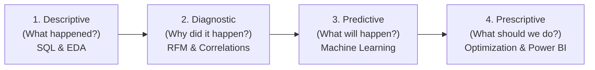
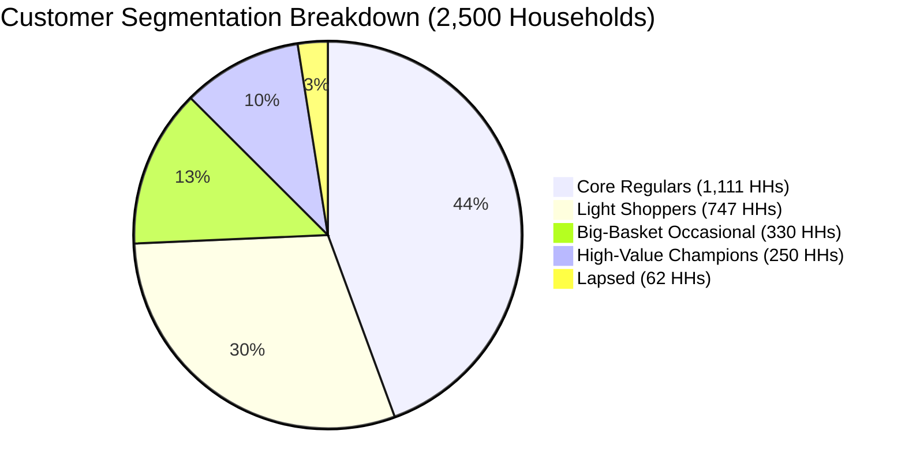
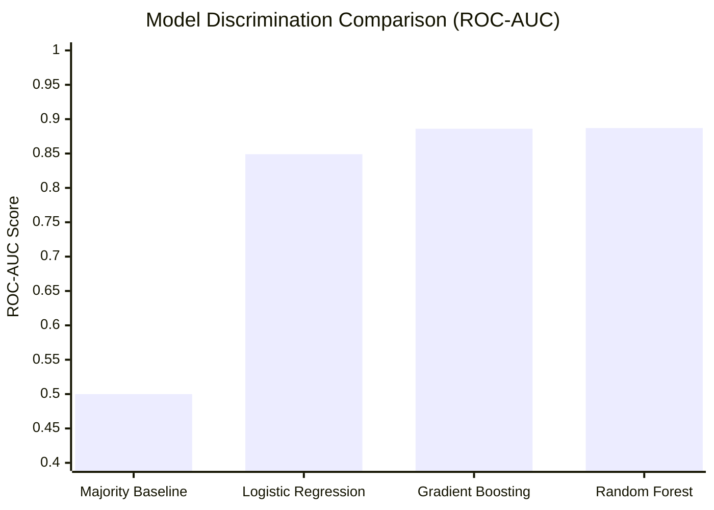
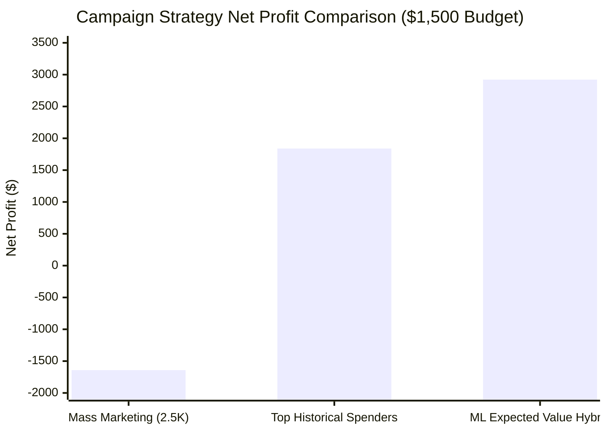

# 🛒 Retail Revenue & Promotion Decision Framework

[](https://www.postgresql.org/)
[](https://www.python.org/)
[](https://scikit-learn.org/)
[](https://powerbi.microsoft.com/)
[](https://opensource.org/licenses/MIT)

An end-to-end retail customer analytics, customer segmentation, predictive modeling, and prescriptive decision-optimization system built on a large-scale household retail dataset (~2.5M transactions, 2,500 households, 92K+ products).

This project tracks the entire modern data analytics progression:  
**Raw Ingestion & SQL Engineering → Statistical EDA & Behavioral Profiling → Unsupervised Segmentation (RFM + K-Means) → Supervised Machine Learning (Campaign Redemption Prediction) → Prescriptive Decision Optimization & What-If Simulations → Interactive Power BI Executive Dashboard.**

---

## 📌 Executive Summary & Key Results

| Dimension | Baseline / Traditional Approach | ML & Prescriptive Optimization | Tangible Business Lift |
|---|---|---|---|
| **Campaign Strategy (500 HHs)** | **Top Spenders Only:** Targets top historical gross revenue | **Expected Value (EV) Hybrid:** $P(\text{Redeem}) \times \text{Margin} - \text{Cost}$ | **+$1,082.71 Net Profit (+58.9%)** on identical $1,500 budget |
| **Campaign Response Rate** | 60.5% conversion rate | **77.3% conversion rate** | **+16.8 percentage point lift** (+84 redemptions) |
| **Mass Marketing Alternative** | **Untargeted Mailer:** Send to all 2,500 households | **Optimized Targeting:** Target top ~500–578 households | **Turns a -$1,641.71 loss into a +$2,922.13 net profit** |
| **Budget Efficiency** | Static arbitrary budget limits | **Marginal Profit Cutoff Curve** | Exact break-even & profit-maximizing allocation points |
| **Predictive Ranking Power** | Ad-hoc heuristics | **Random Forest Classifier** | **0.8869 ROC-AUC** (81.4% accuracy) |

---

## 🎯 Project Goals & Analytical Framework

Retail businesses frequently waste millions on blanket coupon distribution and untargeted marketing collateral. The core objective of this project is to build an analytical decision-support engine answering five strategic executive questions:

1. **Which customer segments should receive marketing attention?**
2. **Which customer groups offer the greatest potential long-term value?**
3. **Which individual households should be prioritized for promotional campaigns?**
4. **How can targeting balance customer responsiveness against basket spend?**
5. **How should marketing budgets be allocated across direct mail vs. digital channels under financial constraints?**

### The 4-Tier Analytical Progression



---

## 🏗️ End-to-End System Pipeline

```mermaid
flowchart TD
    subgraph Data_Layer ["1. Data Engineering & SQL Layer (PostgreSQL)"]
        RawCSV["Raw Retail CSVs<br/>(Transactions, Demographics, Products, Campaigns, Coupons)"] --> RawSchema["PostgreSQL raw Schema"]
        RawSchema --> SQLAudit["Data Profiling & Quality Validation<br/>(01, 02, 03 SQL scripts)"]
        SQLAudit --> SQLSales["Sales & Trend Analysis (04_Sales_analysis.sql)"]
        SQLSales --> MatTables["Analytics Schema Materialization<br/>• customer_features (2.5K rows)<br/>• product_features (92.3K rows)<br/>• campaign_features (1.5K rows)"]
    end

    subgraph Analytics_Layer ["2. Python Exploratory & Feature Engineering (Notebook 01 & 02)"]
        MatTables --> Ingestion["Pandas Analytical Ingestion & Household Join"]
        Ingestion --> EDA["Exploratory Data Analysis (Sections 4.1–4.8)<br/>• Spending Skew & Basket Distributions<br/>• Demographic Realities & Missingness<br/>• Spearman Rank Correlations"]
        EDA --> FeatureEng["Feature Preparation & Imputation (Section 5)<br/>• Derived Behavioral Ratios (Spend Intensity, Diversity)<br/>• Ordinal/Label Categorical Encodings<br/>• log1p Normalization on Skewed Totals"]
    end

    subgraph Segmentation_Layer ["3. Customer Segmentation (Notebook 02)"]
        FeatureEng --> RFM["Rule-Based RFM Scoring (Q1–Q4 Quartiles → 7 Segments)"]
        FeatureEng --> KMeans["K-Means Clustering (StandardScaler, 12 Features)<br/>• Elbow & Silhouette Analysis<br/>• Selected K=5 Actionable Segments"]
        RFM -.-> SegMatrix["Segment Cross-Tabulation & PCA 2D Validation"]
        KMeans -.-> SegMatrix
    end

    subgraph ML_Optimization_Layer ["4. Predictive Modeling & Prescriptive Optimization (Notebook 03)"]
        SegMatrix --> MLTarget["Leakage-Free Formulation (Target: is_campaign_redeemer)<br/>• Filtered to 1,584 Campaign-Exposed Households<br/>• Stratified 80/20 Train/Test Split"]
        MLTarget --> ModelEval["Model Bake-off (Logistic Regression vs. Random Forest vs. Gradient Boosting)"]
        ModelEval --> ChampModel["Champion: Random Forest (ROC-AUC 0.8869)<br/>• Feature Importance: coupon_usage_rate (15.5%), cluster (14.5%)"]
        ChampModel --> ScoreAll["Full Base Scoring: redemption_probability for 2,500 HHs"]
        ScoreAll --> Optimization["Prescriptive Decision Framework (Section 9)<br/>• Retail Unit Economics ($3 mailer cost, 25% margin)<br/>• 2x2 Strategic Targeting Matrix<br/>• Strategy Comparison (Prob vs Spend vs Hybrid EV)"]
        Optimization --> Scenarios["What-If Scenario Simulation (Section 10)<br/>• Budget Scaling Curves (100 to 2.5K HHs)<br/>• Probability Cutoff Sensitivity<br/>• Channel Cost Sensitivity ($1 vs $3 vs $5)"]
    end

    subgraph BI_Layer ["5. Business Intelligence Layer (Power BI)"]
        Scenarios --> OutCSVs["Clean Deliverables (Data/Output/)<br/>• pbi_household_master.csv<br/>• Scenario summary CSVs"]
        OutCSVs --> PBI["Interactive Executive Dashboard (Final_Dashboard.pbix)<br/>1. Executive Overview & KPI Scorecard<br/>2. Customer & Segment Intelligence<br/>3. Campaign & Marketing Analytics<br/>4. Prescriptive ML Targeting Optimizer<br/>5. What-If Scenario Simulator"]
    end
```



---

## 📂 Repository & Project Structure

```text
DataProject/
│
├── Data/
│   ├── Raw/                              # Immutable source CSV files
│   │   ├── campaign_desc.csv             # Marketing campaign metadata
│   │   ├── campaign_table.csv            # Household-to-campaign assignments
│   │   ├── causal_data.csv               # Product promotional display/feature flags
│   │   ├── coupon.csv                    # Coupon-to-product mapping (composite key)
│   │   ├── coupon_redempt.csv            # Household coupon redemption logs
│   │   ├── hh_demographic.csv            # Household demographic survey attributes
│   │   ├── product.csv                   # Department, commodity, and brand taxonomy
│   │   └── transaction_data.csv          # 2.5M POS retail transaction line items
│   │
│   ├── Processed/                        # Intermediate pipeline & modeling data
│   │   ├── coupon_clean.csv              # Deduplicated coupon mappings
│   │   ├── household_engineered.csv      # Full household dataset with derived features
│   │   ├── household_model_ready.csv     # Scaled/encoded numeric modeling matrix
│   │   ├── household_segmented.csv       # Household base tagged with RFM & K-Means clusters
│   │   ├── household_scored.csv          # Scored with predicted redemption probabilities
│   │   └── household_targeting_priority.csv # Tagged with expected profit & priority ranks
│   │
│   └── Output/                           # Final reporting deliverables (Power BI ready)
│       ├── pbi_household_master.csv      # 2,500 households × 51 analytics & decision columns
│       ├── pbi_scenario_budgets.csv      # Budget scaling simulation results (100–2500 HHs)
│       ├── pbi_scenario_channel_costs.csv# Channel delivery cost sensitivity ($1, $3, $5)
│       ├── pbi_scenario_thresholds.csv   # Probability cutoff sensitivity (0.10–0.80)
│       └── pbi_strategy_lift_benchmarks.csv # Strategy comparison & ML value lift data
│
├── Notebooks/
│   ├── 01_data_inspection.ipynb          # Initial exploratory sanity checks & schema profiling
│   ├── 02_Python_EDA.ipynb               # Comprehensive EDA (4.1–4.8), Feature Engineering, RFM & K-Means
│   └── 03_ML_and_Optimization.ipynb      # Supervised ML, Model Evaluation, Optimization & What-If Scenarios
│
├── Power_BI/
│   └── Final_Dashboard.pbix              # 5-page interactive executive Power BI dashboard
│
├── SQL/
│   ├── 01_table_creation.sql             # PostgreSQL DDL & schema setup under raw schema
│   ├── 02_data_profiling.sql             # Row counts, distinct keys, distributions, and null checks
│   ├── 03_data_quality_check.sql         # Referential integrity, orphan keys, duplicate tests
│   ├── 04_Sales_analysis.sql             # SQL KPI aggregation, weekly trends, promotional splits
│   └── 05_analytics_table.sql            # Materializes analytics.customer_features, product_features, campaign_features
│
├── progress.md                           # Comprehensive chronological audit trail & milestone tracker
├── Working_plan.md                       # Complete 17-stage project roadmap & analytical philosophy
└── README.md                             # Project overview, methodology, and results documentation
```

---

## 🗄️ SQL Analytics & Feature Materialization

To handle ~2.5 million transactional rows without repeatedly loading large raw tables into Python, PostgreSQL acts as the high-throughput aggregation engine.

### Analytics Tables Materialized (`analytics` schema)

1. **`customer_features` (2,500 rows × 17 columns):**
   - Behavioral metrics: `total_baskets`, `active_days`, `unique_products`, `total_units_purchased`, `total_spend`.
   - Intensity metrics: `avg_basket_value`, `avg_retail_discount`, `coupon_usage_rate`.
   - Temporal metrics: `recency_days` calculated as $(\text{MAX}(\text{day}) - \text{last\_purchase\_day})$.
   - Demographic attributes left-joined from `raw.hh_demographic`.

2. **`product_features` (92,339 rows × 14 columns):**
   - Catalog roll-up: Total sales revenue, total units sold, distinct households reached, distinct baskets reached, average unit price, retail discount depth, and product-level coupon usage rate.

3. **`campaign_features` (1,584 rows × 5 columns):**
   - Marketing engagement: `campaigns_assigned`, `campaigns_redeemed`, `coupons_redeemed`, and `campaign_redemption_rate`.

---

## 🔍 Exploratory Data Analysis & Feature Engineering

### Critical Exploratory Discoveries
- **Extreme Right-Skewness:** Retail spending and volume follow heavy power-law distributions. Total spend spans from \$11.50 to \$38,319 (median: \$2,492), while total units purchased exhibits extreme positive outliers (max: 4.48M units). Skewness was compressed using $\log(1 + x)$ transformations.
- **Demographic Incompleteness:** Only **801 out of 2,500 households (32.04%)** have demographic records. Rather than discarding 68% of customers, an explicit `has_demographics` flag was engineered and missing categoricals were labeled as `'Unknown'` to retain the entire population for modeling.
- **Campaign Exposure Split:** Only 1,584 households received marketing campaigns; 916 households were never targeted.

### Engineered Behavioral Variables
- **`spend_per_active_day`:** Spend velocity per trip day ($\text{total\_spend} / \text{active\_days}$).
- **`baskets_per_active_day`:** Shopping frequency density.
- **`units_per_basket`:** Basket physical volume.
- **`product_diversity_ratio`:** Breadth of catalog exploration ($\text{unique\_products} / \text{total\_baskets}$).
- **`is_campaign_redeemer`:** Target variable (1 if $\text{campaigns\_redeemed} > 0$, else 0).

---

## 👥 Customer Segmentation Engine

The project implements a dual segmentation framework to combine intuitive business rules with data-driven machine learning discovery.

### 1. Rule-Based RFM Segmentation
Households were scored from 1 to 4 across Recency ($R$), Frequency ($F$), and Monetary ($M$) quartiles:
- **Champions (Score 4-4-4):** Recent, frequent, top spenders.
- **Loyal Customers (F $\ge 3$, M $\ge 3$):** Consistent high-value core shoppers.
- **Potential Loyalists (R $\ge 3$, F $\ge 2$, M $\ge 2$):** Active shoppers with growth potential.
- **At Risk (R $\le 2$, F $\ge 3$):** Lapsing high-frequency customers needing win-back offers.
- **Needs Attention / Hibernating / Others:** Infrequent, low-spend, or long-dormant shoppers.

### 2. Unsupervised K-Means Clustering ($K=5$)
Using 12 standardized behavioral and campaign features, clustering was evaluated across $K=2$ to $K=10$. While $K=2$ yielded the highest mathematical silhouette score, it only separated high vs. low spenders. **$K=5$** (silhouette score: 0.2956) was selected for actionable marketing differentiation.



| Cluster | Business Segment Name | Household Count | Median Spend | Median Baskets | Median Recency | Median Basket Value | Campaign Redemption Rate | Strategic Marketing Playbook |
|---|---|---|---|---|---|---|---|---|
| **0** | **Light Shoppers** | 747 (29.9%) | \$683.30 | 34 | 15 days | \$20.80 | 0.0% | Low-cost digital promotions; basket-building threshold coupons. |
| **1** | **Core Regulars** | 1,111 (44.4%) | \$3,082.50 | 128 | 3 days | \$25.30 | 0.0% | Core revenue backbone; category cross-sell and loyalty point incentives. |
| **2** | **Lapsed** | 62 (2.5%) | \$164.00 | 7 | 293.5 days | \$24.40 | 0.0% | Churned shoppers; aggressive win-back discounts via digital channels only. |
| **3** | **High-Value Champions** | 250 (10.0%) | **\$5,909.60** | **158** | **2 days** | \$40.60 | **50.0%** | **Top priority:** VIP rewards, early access, premium physical catalogs. |
| **4** | **Big-Basket Occasional** | 330 (13.2%) | \$2,561.20 | 46 | 9 days | **\$58.30** | 0.0% | Stock-up shoppers; multi-buy / bulk promotions and volume discounts. |

---

## 🤖 Supervised Machine Learning: Campaign Redemption Prediction

### Problem Definition & Data Leakage Prevention
- **Target Variable:** `is_campaign_redeemer` (binary classification).
- **Population:** Filtered strictly to the **1,584 households** with recorded campaign assignments (excluding the 916 unexposed households to prevent non-response bias).
- **Strict Leakage Prevention:** Outcome-derived fields (`campaigns_redeemed`, `coupons_redeemed`, `campaign_redemption_rate`, `was_campaign_targeted`) were removed from features.
- **Validation:** 80/20 stratified train/test split.

### Model Performance Comparison

| Model | Test Accuracy | Precision | Recall | F1-Score | ROC-AUC | Best Used For |
|---|---|---|---|---|---|---|
| **Majority Baseline** | 76.0% | 0.0% | 0.0% | 0.0000 | 0.5000 | Naive benchmark |
| **Logistic Regression** | 77.60% | 57.14% | **73.56%** | 0.6432 | 0.8491 | Linear interpretability |
| **Random Forest (Champion)** | **81.39%** | **64.89%** | 70.11% | **0.6740** | **0.8869** | **Primary scoring engine & ranking** |
| **Gradient Boosting** | 81.39% | 64.89% | 70.11% | 0.6740 | 0.8857 | Sequential error correction |



### Top 5 Predictive Features (Gini Importance)
1. **`coupon_usage_rate` (15.5%):** Prior habit of using store/manufacturer coupons in regular shopping is the #1 predictor of promotional response.
2. **`cluster` (14.5%):** Unsupervised behavioral segment captures engagement propensity (redeemers heavily concentrate in *High-Value Champions*).
3. **`total_spend_log` / `total_spend` (12.4%):** Spend scale directly correlates with responsiveness (redeemers spend +99.6% more: \$5,652 vs. \$2,832).
4. **`unique_products` (4.3%):** Catalog breadth exploration (redeemers purchase 930 unique items vs. 586).
5. **`campaigns_assigned` (3.3%):** Brand familiarity and campaign touchpoint exposure.

---

## 📈 Prescriptive Analytics & Decision Optimization

Predictive models only provide probabilities. The optimization framework combines probability with retail unit economics to prescribe profitable business decisions.

### Retail Unit Economics
- **Mailing Delivery Cost ($C$):** \$3.00 per household.
- **Retail Gross Margin Rate ($M$):** 25% on purchase basket.
- **Expected Value Metric:**
  $$\text{EV} = P(\text{Redeem}) \times (0.25 \times \text{avg\_basket\_value}) - \$3.00$$

### 500-Household Campaign Strategy Bake-Off ($1,500 Budget)

| Targeting Strategy | Households Targeted | Budget Cost | Expected Redemptions | Conversion Rate | Expected Net Profit | ROI (%) | Financial Lift vs. Traditional Spend |
|---|---|---|---|---|---|---|---|
| **Strategy A: Pure ML Probability** | 500 | \$1,500 | 386.6 | 77.3% | \$2,922.13 | 194.8% | +$1,082.71 (+58.9%) |
| **Strategy B: Pure Historical Spend** | 500 | \$1,500 | 302.7 | 60.5% | \$1,839.42 | 122.6% | Baseline (\$0.00) |
| **Strategy C: Expected Value Hybrid** | **500** | **\$1,500** | **386.6** | **77.3%** | **\$2,922.13** | **194.8%** | **+$1,082.71 (+58.9% profit lift)** |
| **Baseline: Mass Marketing** | 2,500 | \$7,500 | 600.0 | 24.0% | **-$1,641.71** | **-21.9%** | **+$4,563.84 turnaround** |



---

## 🧪 What-If Scenario Simulations

### 1. Budget Scaling & Diminishing Marginal Returns
- **Maximum Capital Efficiency:** 100 households yields **429.5% ROI** (91.5% conversion rate).
- **Maximum Total Dollar Profit:** Peaks at **~500 to 578 households**, generating **$2,922 to $2,952 in net profit**.
- **The Profit Cliff:** Beyond 750 households, marginal redemptions drop below the \$3.00 mailer cost. At 2,000 households, net profit flips negative (-$163.33).

### 2. Probability Eligibility Thresholds
- Setting a strict threshold of $P \ge 0.70$ delivers elite precision (91.1% conversion, \$2,453 profit), but leaves profitable volume behind.
- **The Optimal Threshold is $P \ge 0.30$**, qualifying **624 households** and maximizing net profit at **$2,764.06** (73.6% conversion).

### 3. Channel Cost Sensitivity & Multi-Channel Deployment
- **Low-Cost Digital ($1.00 unit cost):** Optimal target count expands to **1,009 households** generating **$4,446.43 net profit**. The entire customer base (2,500 HHs) operates above break-even.
- **Standard Direct Mail ($3.00 unit cost):** Optimal at **578 households** (\$2,951.94 profit); break-even point is 1,943 households.
- **Premium Catalog Kit ($5.00 unit cost):** Optimal at **408 households** (\$1,991.89 profit); steep financial losses occur if mailed to more than 1,108 households.

---

## 📊 Power BI Business Intelligence Dashboard

The finalized reporting layer is packaged in [`Power_BI/Final_Dashboard.pbix`](file:///D:/DataProject/Power_BI/Final_Dashboard.pbix), connected to the clean exports in `Data/Output/`.

### Dashboard Architecture (5 Dedicated Pages)

1. **Executive Overview & KPI Scorecard:**
   - C-suite KPI cards: Total Revenue (\$7.83M), Total Households (2,500), Total Baskets (276K), Average Basket (\$28.32).
   - Revenue and customer distribution across the 5 K-Means clusters.
   - Summary of ML targeting net profit lift over traditional mass marketing.

2. **Customer & Segment Intelligence:**
   - Interactive bubble chart: Recency vs. Total Spend vs. Frequency by segment.
   - Basket size comparison highlighting the *Big-Basket Occasional* segment (\$58.30 basket).
   - RFM segment vs. K-Means cluster cross-matrix and demographic composition slicers.

3. **Campaign & Marketing Analytics (Historical):**
   - Targeted (63.4%) vs. untargeted (36.6%) household reach breakdown.
   - Actual redemption rate distribution by segment (*High-Value Champions* at 50%).
   - Coupon usage intensity across spending deciles.

4. **Prescriptive ML & Targeting Optimizer:**
   - 2×2 Strategic Targeting Matrix: High/Low Spend vs. High/Low Response.
   - Interactive customer target list filtered by probability and expected campaign profit.
   - Live KPI cards tracking expected redemptions, spend, and ROI for selected cohorts.

5. **What-If Scenario Simulator:**
   - Budget scaling trade-off curves (Net Profit vs. ROI dual-axis line chart).
   - Probability threshold sensitivity slicers ($P \ge 0.10$ to $0.80$).
   - Delivery channel sensitivity comparison (Digital \$1.00 vs. Mail \$3.00 vs. Catalog \$5.00).

---

## 🔑 Comprehensive KPI Dictionary

| Metric Name | Formula / Definition | Project Value | Business Significance |
|---|---|---|---|
| **Total Revenue** | $\sum \text{sales\_value}$ across all transactions | **\$7,828,881.04** | Total store sales volume over 2-year period. |
| **Household Reach** | Count of distinct `household_key` | **2,500** | Total customer base tracked in POS system. |
| **Total Baskets** | Count of distinct `basket_id` | **276,484** | Aggregate transaction trip count. |
| **Average Basket Value** | $\text{Total Revenue} / \text{Total Baskets}$ | **\$28.32** | Baseline spending per shopping trip. |
| **Historical Campaign Reach** | Households assigned to $\ge 1$ campaign | **1,584 (63.36%)** | Proportion of customer base historically targeted. |
| **Historical Redemption Rate** | Households redeeming $\ge 1$ coupon / Targeted | **24.0%** | Untargeted baseline conversion benchmark. |
| **Model Ranking Power (AUC)** | Area under ROC Curve (Random Forest) | **0.8869** | 88.7% probability of correctly ranking a redeemer above a non-redeemer. |
| **Optimized Conversion Rate** | Expected redemptions / Top 500 target cohort | **77.3%** | +16.8 percentage point lift over traditional targeting. |
| **Targeting Net Profit (Top 500)** | Gross Margin Gain - \$1,500 Campaign Cost | **\$2,922.13** | Net return generated by prescriptive ML selection. |
| **Targeting ROI (Top 500)** | Net Profit / Campaign Cost | **194.8%** | Return on marketing investment. |

---

## 🚀 How to Run & Reproduce

### 1. Prerequisites
- **PostgreSQL 14+** (with credentials configured in `psycopg2`)
- **Python 3.10+** (Jupyter Notebook / JupyterLab)
- **Power BI Desktop** (August 2023 release or newer)

### 2. Environment Setup
```bash
# Clone the repository
git clone https://github.com/your-username/retail-customer-analytics.git
cd retail-customer-analytics

# Create and activate a virtual environment
python -m venv venv
source venv/bin/activate  # On Windows: .\venv\Scripts\activate

# Install required dependencies
pip install pandas numpy scipy matplotlib seaborn scikit-learn sqlalchemy psycopg2
```

### 3. Database Execution
Execute the SQL files in order inside PostgreSQL:
```bash
psql -U postgres -d DataProject -f SQL/01_table_creation.sql
psql -U postgres -d DataProject -f SQL/02_data_profiling.sql
psql -U postgres -d DataProject -f SQL/03_data_quality_check.sql
psql -U postgres -d DataProject -f SQL/04_Sales_analysis.sql
psql -U postgres -d DataProject -f SQL/05_analytics_table.sql
```

### 4. Notebook Execution
Open Jupyter Notebook and run sequentially:
1. `Notebooks/01_data_inspection.ipynb` — Confirms schema and data load integrity.
2. `Notebooks/02_Python_EDA.ipynb` — Executes statistical analysis, feature engineering, and segmentation.
3. `Notebooks/03_ML_and_Optimization.ipynb` — Trains models, computes expected value scores, simulates scenarios, and exports `Data/Output/` datasets.

### 5. Power BI Dashboard
1. Open `Power_BI/Final_Dashboard.pbix` in Power BI Desktop.
2. If file paths differ, select **Transform Data → Data Source Settings** and point the CSV sources to your local `Data/Output/` directory.
3. Click **Apply Changes** to refresh visuals.

---

## 💡 Strategic Business Recommendations

1. **Eliminate Untargeted Mass Mailings:** Blanket direct mailings to the entire base produce a guaranteed loss (-$1.6K). Transition all direct mail campaigns to the **top ~500–580 Expected Value households**.
2. **Deploy an Omnichannel Targeting Tier:**
   - *Tier 1 (Top ~400 HHs):* High-touch physical catalog kits and personalized print coupons (\$5.00 delivery cost).
   - *Tier 2 (HHs 401–600):* Standard direct mail postcards (\$3.00 delivery cost).
   - *Tier 3 (HHs 601–1,000):* Low-cost personalized digital app push notifications and email coupons (\$1.00 delivery cost).
3. **Differentiate Messaging by K-Means Segment:**
   - *High-Value Champions (Cluster 3):* VIP loyalty rewards, exclusive early product access, and brand partnerships (do not discount commodities they already purchase at full price).
   - *Big-Basket Occasionals (Cluster 4):* Volume thresholds (e.g., *"Save \$15 on orders over \$75"*) to capitalize on their high basket capacity (\$58.30).
   - *Core Regulars (Cluster 1):* Cross-category recommendations to expand department exploration beyond grocery staples.
   - *Light Shoppers (Cluster 0):* Low-cost digital coupons to stimulate repeat visits.
4. **Institutionalize the Expected Value Metric:** Cease ranking target audiences purely on historical revenue. Prioritize customers based on **Expected Value ($EV$)**, ensuring marketing budgets capture both high propensity to respond and profitable basket sizes.

---

## 📜 License
This project is licensed under the MIT License - see the [LICENSE](LICENSE) file for details.
